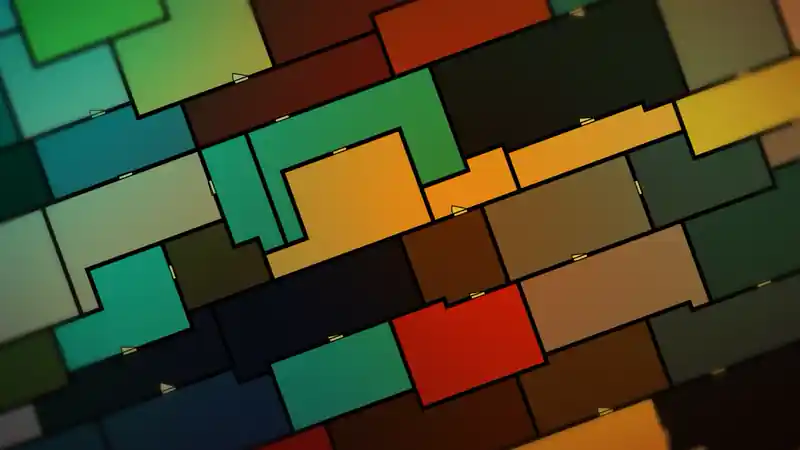
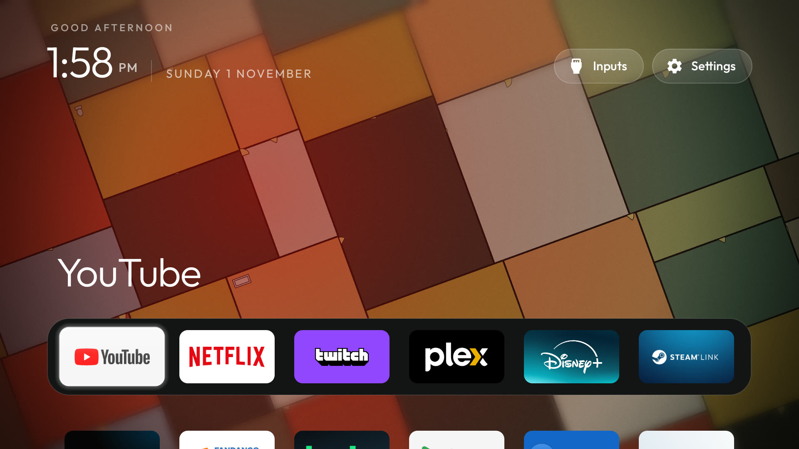
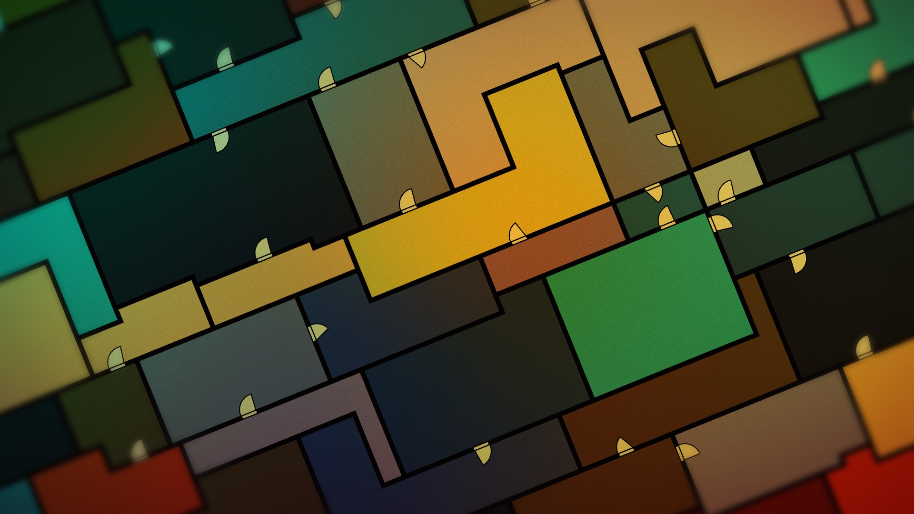
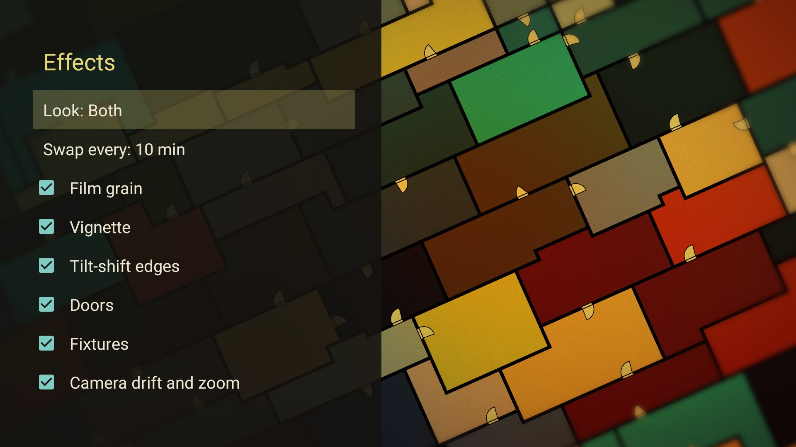

# Tatami

A home screen and screensaver for Android TV. Behind your apps, small rooms rearrange themselves in slow, quiet
motion. It is inspired by the ending of *The Tatami Galaxy* (2010). It has two looks, and by default they take
turns:

- **Nagaya**: rows of small, warm rooms, like a row house. A few walls at a time glide to new places, each on its
  own time, and then rest. The doors swing open and shut in a slow ripple, and the camera slowly rolls, zooms and
  drifts.
- **Yojōhan**: olive rooms cut like tatami mats around a half mat. One room grows while the room next to it
  shrinks.



| Home | Screensaver | Effects |
|---|---|---|
|  |  |  |

Tested on a Sony Android TV 10 at 1080p, where it runs at a steady 60 fps. Tatami is drawn live with OpenGL and
uses no footage from the show. It has no internet permission, so nothing leaves the TV.

## Two ways to use it

| | **Tatami Home** | **Tatami add-on** |
|---|---|---|
| What you get | [cleanyourtv](https://github.com/Gathin23/cleanyourtv)'s launcher with Tatami behind your apps, and the screensaver | The screensaver, and a Tatami card on cleanyourtv's own launcher (a tile on any other launcher) |
| Behind your apps | Tatami, moving. After 2 idle minutes the apps fade and only Tatami shows | Your launcher's own wallpaper |
| Permissions | The launcher's own ([what and why](docs/how-it-works.md#what-it-asks-for)) | None |
| Install | [Tatami Home](#install-tatami-home) | [The add-on](#or-install-only-the-add-on) |

You need only one of the two.

## Install Tatami Home

You need:

- JDK 17 and the Android SDK (platform 34, build-tools 34.0.0).
- A [cleanyourtv](https://github.com/Gathin23/cleanyourtv) checkout in a folder next to this repo, with its
  `tools/venv` set up as its README says. The install script uses it to talk to the TV. If it is somewhere
  else, set `CLEANYOURTV` to its full path.

```bash
./gradlew -p home testReleaseUnitTest assembleRelease
TV_HOST=192.168.1.50 home/install.sh          # install or update
TV_HOST=192.168.1.50 home/install.sh --home   # also make Tatami Home your Home
```

Your old launcher stays installed, so you can always go back. `--home` prints the command that does it.

## Or install only the add-on

Same needs as above. The script builds the add-on, installs it, makes it the TV's screensaver and opens it once:

```bash
TV_HOST=192.168.1.50 ./install.sh                # macOS, Linux, Git Bash
TV_HOST=192.168.1.50 ./install.sh --uninstall    # your old screensaver back, the add-on removed
```

On Windows without Bash: `powershell -ExecutionPolicy Bypass -File install.ps1 -TvHost 192.168.1.50`.

## Use it

- **Home** works like cleanyourtv's launcher. See [its guide](https://github.com/Gathin23/cleanyourtv/blob/main/docs/launcher.md).
  When the apps have faded, the first key press only brings them back. Volume keys still change the volume.
- **Look and effects:** in Tatami Home, hold OK on **Settings**, then pick **Launcher settings** > **Floor plan
  effects**, or open the *Tatami Home* tile and press OK. With the add-on, press OK on its card, then OK again.
  - The first row picks the **Look**: Both (the default), Nagaya or Yojōhan.
  - The next sets how often Both swaps looks: every 5, 10, 30 or 60 minutes, with a short dip to dark.
  - Below them, turn each effect on or off and see it change behind the list: film grain, vignette, tilt-shift
    edges, doors, fixtures, and camera drift and zoom. In Nagaya, the vignette switch turns its colour wash on and
    off, the camera switch holds the view still, and fixtures do nothing.
- **Screensaver:** TV Settings > Device Preferences > Screen saver > *Tatami Home* (or *Tatami* for the add-on).
  It uses the same look and effects. It starts when the TV's own wait runs out: Screen saver > When to start.

## Tatami Home settings

Tatami Home takes every setting in cleanyourtv's [theme guide](https://github.com/Gathin23/cleanyourtv/blob/main/themes/README.md),
plus 3 of its own:

| Key | Default | What it does |
|---|---|---|
| `floor_plan` | `true` | Show Tatami behind Home. `false` gives you the launcher's normal wallpaper. |
| `floor_plan_dim` | `35` | How much to darken Tatami behind the apps, from 0 to 90 %. |
| `floor_plan_idle_minutes` | `2` | Minutes with no key press before the apps fade. `0` turns the fade off. |

Keep your own settings out of this repo. Put them in a `config.json` in a folder of your own:

```json
{
  "greeting_name": "Sam",
  "columns": 6,
  "dock_apps": ["com.google.android.youtube.tv", "com.netflix.ninja", "tv.twitch.android.app"]
}
```

Then send them to the TV:

```bash
TV_HOST=192.168.1.50 home/tools/theme.sh ~/my-tatami-theme     # add --reset to remove them
```

Sending or removing settings clears the choices you made in Launcher settings on the TV.

## Credits

- Heavily inspired by the ending of *The Tatami Galaxy* (Madhouse, 2010). This is a fan work.
- Tatami Home is [cleanyourtv](https://github.com/Gathin23/cleanyourtv)'s launcher by Gathin (MIT).
- The Outfit font ([SIL OFL 1.1](home/FONT-LICENSE-OFL.txt)) and the Halloween skin's icons from Microsoft's
  Fluent Emoji ([MIT](home/ICONS-LICENSE-FLUENT-EMOJI.txt)) come with the launcher.

How Tatami is drawn and tested, and what Tatami Home changed in cleanyourtv's code:
[docs/how-it-works.md](docs/how-it-works.md).

## License

MIT: [LICENSE](LICENSE).
