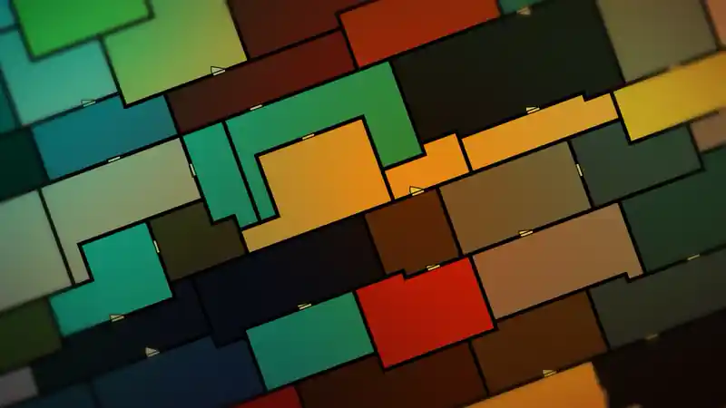
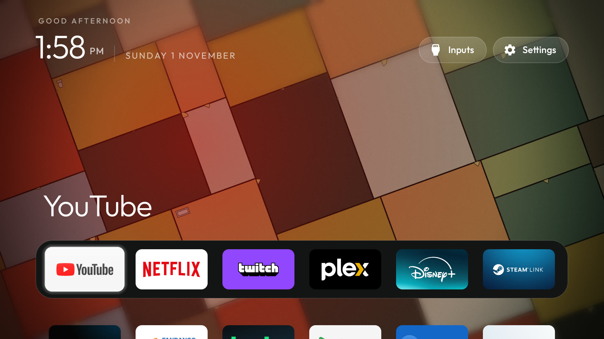
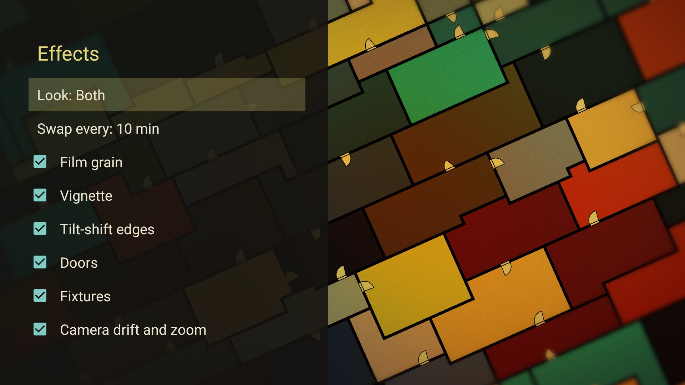

# Tatami Home

A home screen and screensaver for Android TV: cleanyourtv's launcher, with [Tatami](../README.md) moving behind
your apps. Tatami is inspired by the ending of *The Tatami Galaxy* (2010). It has two looks, and by default they
take turns:

- **Nagaya**: rows of small, warm rooms, like a row house. A few walls at a time glide to new places, each on its
  own time, and then rest. The doors swing open and shut in a slow ripple, and the camera slowly rolls, zooms and
  drifts.
- **Yojōhan**: olive rooms cut like tatami mats around a half mat. One room grows while the room next to it
  shrinks.



The home screen is [cleanyourtv](https://github.com/Gathin23/cleanyourtv)'s launcher with the plan behind it.
Leave the remote alone for 2 minutes and the apps fade out, so only the plan shows. Press any key to bring them
back.

| Home | Screensaver | Effects |
|---|---|---|
|  |  |  |

It was tested on a Sony Android TV 10 at 1080p, where it runs at a steady 60 fps. The plan is drawn live with
OpenGL and uses no footage from the show. Tatami has no internet permission, so nothing leaves the TV
([what it asks for, and why](../docs/how-it-works.md#what-it-asks-for)).

Only want Tatami as a screensaver and a card on cleanyourtv's own launcher? Install the
[Tatami add-on](../README.md) instead. You need only one of the two.

## Install

You need:

- JDK 17 and the Android SDK (platform 34, build-tools 34.0.0).
- A [cleanyourtv](https://github.com/Gathin23/cleanyourtv) checkout in a folder next to this repo, with its
  `tools/venv` set up as its README says. The install script uses it to talk to the TV. If it is somewhere
  else, set `CLEANYOURTV` to its full path.

```bash
./gradlew -p home testReleaseUnitTest assembleRelease
TV_HOST=192.168.1.50 home/install.sh          # install or update
TV_HOST=192.168.1.50 home/install.sh --home   # also make Tatami Home your Home
```

Your old launcher stays installed, so you can always go back. `--home` prints the command that does it.

## Use it

- **Home** works like cleanyourtv's launcher. See [its guide](https://github.com/Gathin23/cleanyourtv/blob/main/docs/launcher.md).
- **Look and effects:** hold OK on **Settings**, then pick **Launcher settings** > **Floor plan effects**. Or open
  the *Tatami Home* tile in the app list and press OK. The first row picks the **Look**: Both (the default), Nagaya or Yojōhan. The next sets how often Both swaps looks:
  every 5, 10, 30 or 60 minutes, with a short dip to dark. Below them, turn each effect on or off and see it change
  behind the list: film grain, vignette, tilt-shift edges, doors, fixtures, and camera drift and zoom. All are on
  at first. In Nagaya, the vignette switch turns its colour wash on and off, the camera switch holds the view still
  (the walls and doors still move), and fixtures do nothing.
- **Screensaver:** in TV Settings, go to Device Preferences > Screen saver > *Tatami Home*. It uses the
  same look and effects as Home.
- **Without making it Home:** open the *Tatami Home* tile from your current launcher to see the plan. Press
  OK there for the effects.

When the apps have faded, the first key press only brings them back. It does not open anything. Volume keys
still change the volume.

## Settings

Tatami takes every setting in cleanyourtv's [theme guide](https://github.com/Gathin23/cleanyourtv/blob/main/themes/README.md),
plus 3 of its own:

| Key | Default | What it does |
|---|---|---|
| `floor_plan` | `true` | Show the plan behind Home. `false` gives you the launcher's normal wallpaper. |
| `floor_plan_dim` | `35` | How much to darken the plan behind the apps, from 0 to 90 %. |
| `floor_plan_idle_minutes` | `2` | Minutes with no key press before the apps fade. `0` turns the fade off. |

Keep your own settings out of this repo. Put them in a `config.json` in a folder of your own:

```json
{
  "greeting_name": "Sam",
  "columns": 6,
  "dock_apps": ["com.google.android.youtube.tv", "com.netflix.ninja", "tv.twitch.android.app"]
}
```

Then send them to the TV:

```bash
TV_HOST=192.168.1.50 home/tools/theme.sh ~/my-tatami-theme     # add --reset to remove them
```

Sending or removing settings clears the choices you made in Launcher settings on the TV.

## Credits

- Heavily inspired by the ending of *The Tatami Galaxy* (Madhouse, 2010). This is a fan work.
- The home screen is [cleanyourtv](https://github.com/Gathin23/cleanyourtv)'s launcher by Gathin (MIT).
- The Outfit font ([SIL OFL 1.1](FONT-LICENSE-OFL.txt)) and the Halloween skin's icons from Microsoft's Fluent
  Emoji ([MIT](ICONS-LICENSE-FLUENT-EMOJI.txt)) come with the launcher.

How the plan is drawn, and what Tatami changed in cleanyourtv's code: [docs/how-it-works.md](../docs/how-it-works.md).

## License

MIT: [LICENSE](LICENSE).
